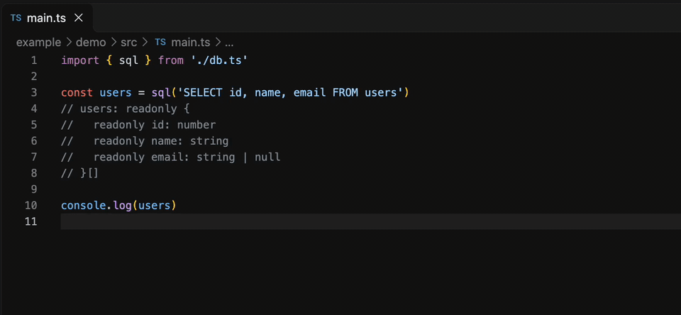

<p align="center">
  
</p>

# inferql

Typed SQL for TypeScript. Write the query as a string: `sql()` runs it and returns rows typed
from the query text and your `.sql` migrations — no code generation, no schema file — and an
oxlint rule checks every query against the real database. SQLite, MySQL and PostgreSQL.



```sql
-- migrations/001_init.sql
CREATE TABLE users (
  id INTEGER PRIMARY KEY,
  name TEXT NOT NULL,
  email TEXT
);
```

```ts
import { connect } from 'inferql/sqlite'

const sql = connect('app.db')

const users = sql('SELECT id, name, email FROM users')
// readonly { readonly id: number; readonly name: string; readonly email: string | null }[]

sql('SELECT id, name FROM users WHERE id = ?', 'one') // type error: id is a number
sql('SELECT nmae FROM users') // lint error: no such column: nmae
```

## Install

```sh
npm install inferql
npm install -D typescript@beta oxlint   # TypeScript 7.1+
```

## Setup

Tell TypeScript about the migrations in `tsconfig.json`, and type-check with
`tsc --noEmit --runExternalCode`:

```jsonc
{
  "include": ["src", "migrations"],
  "contentMappers": [
    {
      "package": "inferql",
      "extensions": [".sql"],
      "options": { "dialect": "sqlite", "migrationsDir": "migrations" },
    },
  ],
}
```

Check every query against the database with oxlint:

```ts
// oxlint.config.ts
import { defineConfig } from 'oxlint'

export default defineConfig({
  jsPlugins: ['inferql/oxlint'],
  rules: {
    'inferql/check-sql': [
      'error',
      { connections: { dialect: 'sqlite', migrationsDir: 'migrations' } },
    ],
  },
})
```

MySQL and PostgreSQL: `connect` from `inferql/mysql` / `inferql/postgres`, which return a promise.

## License

Distributed under the MIT License. See [LICENSE](https://github.com/nakita628/inferql?tab=MIT-1-ov-file) for more information.
